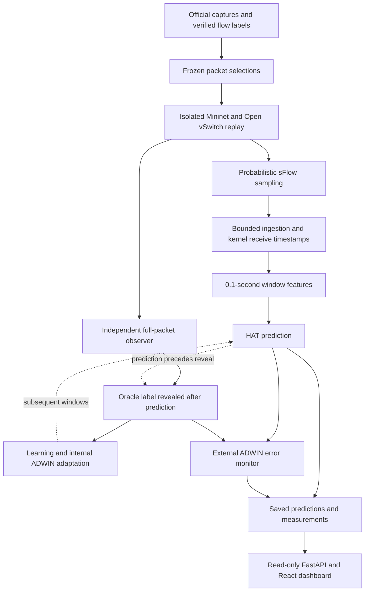
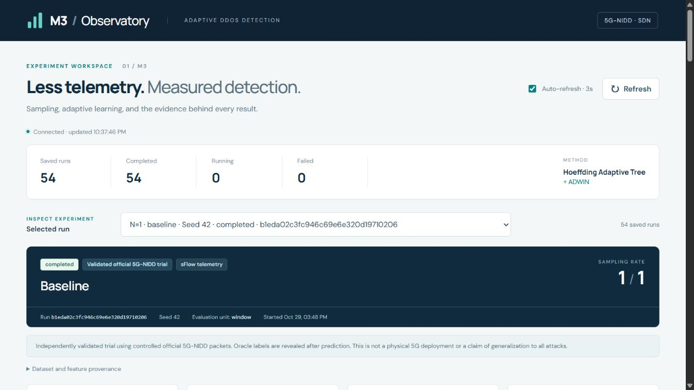
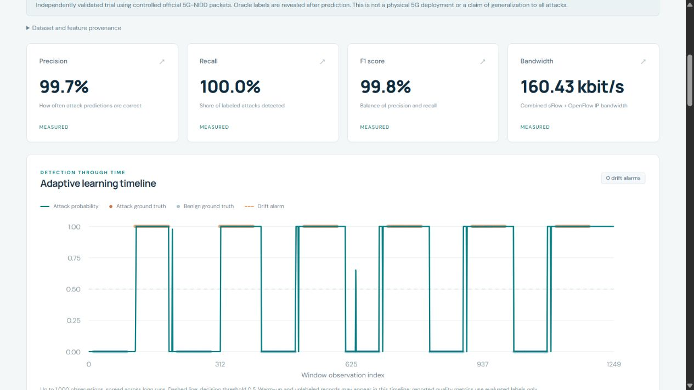
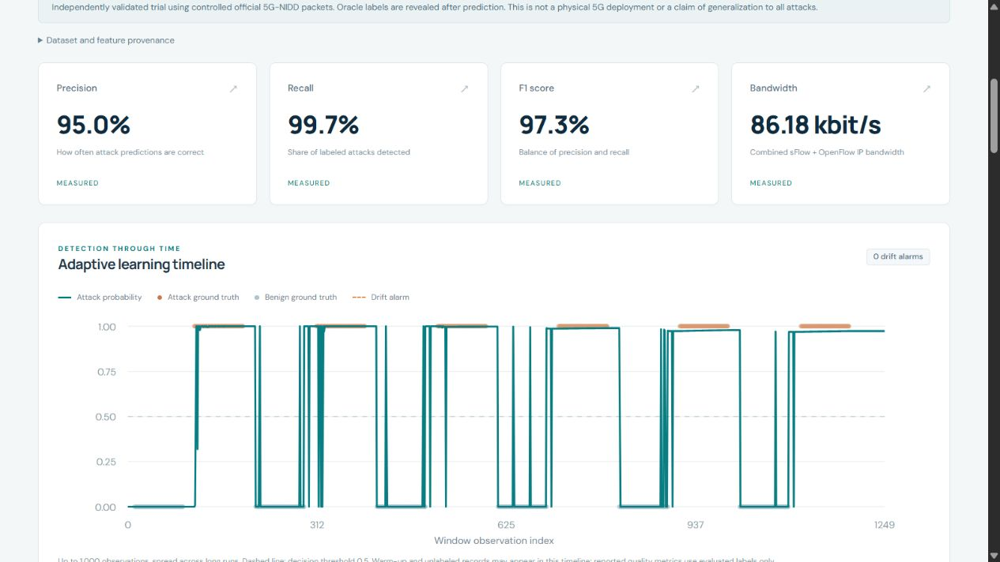
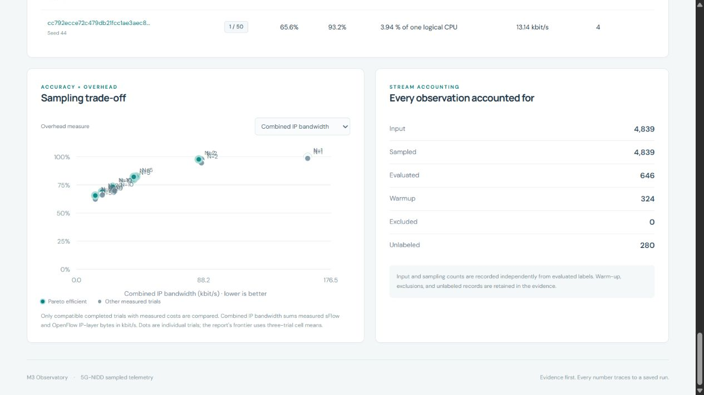

# M3 Sampled Telemetry and Adaptive Flood Detection

M3 investigates how collecting fewer packet headers changes flood-detection
quality and monitoring cost. It uses probabilistic switch sampling, a Hoeffding
Adaptive Tree with ADWIN, and an evidence-backed results dashboard.

**Implementation and controlled study complete:** 54 accepted primary trials
using the official 5G-NIDD release. M3 is joint work by Nithis Nandhan E and
Jaivarshan V within the [three-pipeline project](../../../README.md).

**Controlled-lab scope:** selected official packets are replayed through
Mininet/Open vSwitch with constructed timing and experimental oracle labels.
The results do not establish physical 5G deployment performance or production
readiness. The application displays M3 results only.

## M3 architecture



The detector predicts before reading each current label, then learns from it.
HAT's internal ADWIN adaptation and the separate error monitor have different
roles; a drift alarm is not itself an attack classification.

## Dashboard and short demo



[View the animated dashboard walkthrough](docs/media/m3-walkthrough.gif) or follow
the [short demo guide](docs/m3-dashboard-demo.md).
These views display **saved experimental results**. Opening the dashboard does
not start a new network replay or training run. The walkthrough uses individual
baseline trials at seed 42; the table below summarizes all three repeats.

<details>
<summary>More dashboard views: predictions, sampled metrics and trade-offs</summary>

### Unsampled reference and prediction timeline



The unsampled baseline trial at seed 42 displays 99.8% F1 and 160.43 kbit/s.
The timeline compares predicted attack probabilities with independent
experimental labels. These are individual-trial values, not repeated-trial means.

### Sampled trial and prediction timeline



The corresponding N=2 trial displays 97.3% F1 and 86.18 kbit/s. Using the same
scenario and seed makes the change in monitoring cost and prediction quality
visible; the complete study table includes all three repeats and false positives.

### Sampling trade-off and observation accounting



Each dot represents one compatible completed baseline trial. The adjacent panel
separates evaluated, warm-up and unlabeled observations for the selected N=2,
seed-42 trial. The plot uses F1 and combined sFlow/OpenFlow IP-layer bandwidth.

</details>

## M3 results

The current study contains **54 accepted primary trials**: three scenarios,
six sampling values (`N = 1, 2, 5, 10, 20, 50`) and three model seeds per setting.
The separate pilot and nine repair-validation runs are excluded.

| Scenario | N=1 mean attack F1 | N=2 mean attack F1 | N=2 mean false-positive rate | N=2 bandwidth reduction versus N=1 |
|---|---:|---:|---:|---:|
| Baseline | 99.44% | 96.51% | 6.75% | 46.42% |
| Constructed drift | 98.97% | 96.44% | 7.24% | 46.09% |
| SYN excluded from warm-up | 99.33% | 96.90% | 6.19% | 46.74% |

Bandwidth means measured sFlow plus OpenFlow **IP-layer** kbit/s. N=1 is the
unsampled M3 reference. It has the highest mean F1 in each scenario; the fixed
equal-weight quality/cost criterion selects N=2 as a descriptive compromise.
More aggressive sampling reduces bandwidth further and produces substantial
false positives. F1 is not accuracy.

[Full means, sample SD and intervals](research/results/kernel_ingestion_v2_20261029/aggregated_metrics.csv)
· [Frozen protocol](research/results/kernel_ingestion_v2_20261029/protocol.json)
· [Evidence gates and provenance](research/results/kernel_ingestion_v2_20261029/README.md)

Repeated trials reuse fixed packet selections. Natural attack intensity and
chronology are not preserved, and production labels would not automatically be
available. The study uses 100 packets/s replay, 41-second warm-up, 0.1-second
windows and a 0.5-second window-closure holdback before prediction. It establishes
repeatability in this lab, not a population-wide optimum or general protection
against unseen attacks. No advantage from adaptation alone is claimed.

## Run the M3 dashboard

Requirements: Python 3.12, Node.js/npm and Git. From a fresh repository clone,
run these commands in PowerShell. Use a new, empty `output/published-study`
destination when extracting the evidence.

```powershell
cd M3-sampled-incremental/results/m3-implementation
python -m venv .venv
.venv/Scripts/python.exe -m pip install -e ".[dev,report]"
cd frontend
npm ci
npm run build
cd ..
.venv/Scripts/python.exe -m zipfile -e research/results/kernel_ingestion_v2_20261029/derived_trial_evidence.zip output/published-study
.venv/Scripts/python.exe -m m3.cli serve --runs output/published-study --port 8000
```

Open **http://127.0.0.1:8000/**. Original packet captures and Mininet are not
needed to inspect the archived study through the dashboard.

For a new live experiment, use the [current kernel-clock reproduction commands](docs/technical-guide.md#reproduce-the-live-study)
in a dedicated Linux/WSL2 Mininet/OVS environment.

## Tests and verification

From the M3 implementation directory:

```powershell
.venv/Scripts/python.exe -m pytest
.venv/Scripts/python.exe -m ruff check src/m3 sdn scripts tests
cd frontend
npm test
npm run build
```

Tests cover independent ground truth, window accounting and learning order,
bounded ingestion and missing-timestamp failures, frozen protocol/resume guards,
API validation and dashboard handling of failed or unavailable evidence.

The archived verification records **247 Python tests passed, one optional test
skipped**, plus **18 frontend tests passed** and a successful production build.
All 54 primary trials passed the study's evidence gates. These are recorded
checks, not a promise of identical performance on another machine. See the
[verification details](docs/technical-guide.md#verification)
and [backup verification receipt](BACKUP_VERIFICATION.json).

## Contributions

| Contributor | Contribution |
|---|---|
| **Nithis Nandhan E** | M3 software implementation, investigation and formal analysis, including the controlled live study |
| **Jaivarshan V** | Joint M3 investigation; manuscript drafting and review/editing |
| **Kalaavathi B** | Supervision |

M3 is joint work by Nithis and Jaivarshan. The [overall project README](../../../README.md)
records the separate M1 and M2 team contributions.

## Evidence and repository guide

- **[Technical guide](docs/technical-guide.md):** the full implementation notes, kernel-clock reproduction commands, validation record and historical evidence.
- **[Code guide](docs/code-guide/README.md):** source structure and file explanations; check current source for changes since the guide was written.
- **[Verified backup release](https://github.com/sanjayy-j/ml-ddos-detection-sdn-5g-nidd/releases/tag/m3-backup-2026-10-29):** large original/derived data and raw experiment evidence. Git clone alone does not download these assets; follow the [restore guide](docs/github-backup.md).
- **Historical results and reports** are retained for audit. Use `research/results/kernel_ingestion_v2_20261029/` for the current M3 study; earlier report/PDF/slides linked inside the implementation directory describe older results.

```text
src/m3/       Detector, evidence API and CLI
sdn/          Controller, replay and observation
frontend/     React results dashboard
configs/      Experiment configurations
tests/        Python regression tests
research/results/kernel_ingestion_v2_20261029/
              Current M3 evidence package
docs/         Methods, code guide, screenshots and walkthrough
```

## Licence and dataset

Original project source code and its software documentation are licensed under
the [MIT License](LICENSE). Copyright remains with the respective contributors.
Research manuscripts, presentation materials, research figures and dataset files
are outside that code licence. Third-party components retain their own terms.

5G-NIDD is the dataset creators' work, supplied through the
[official Fairdata release](https://doi.org/10.23729/e80ac9df-d9fb-47e7-8d0d-01384a415361)
under [CC BY 4.0](https://creativecommons.org/licenses/by/4.0/).
[Source attribution and citation](docs/data-source.md)
and [modification details](docs/github-backup.md#dataset-attribution)
are retained with the project. No endorsement by the dataset creators is implied.
