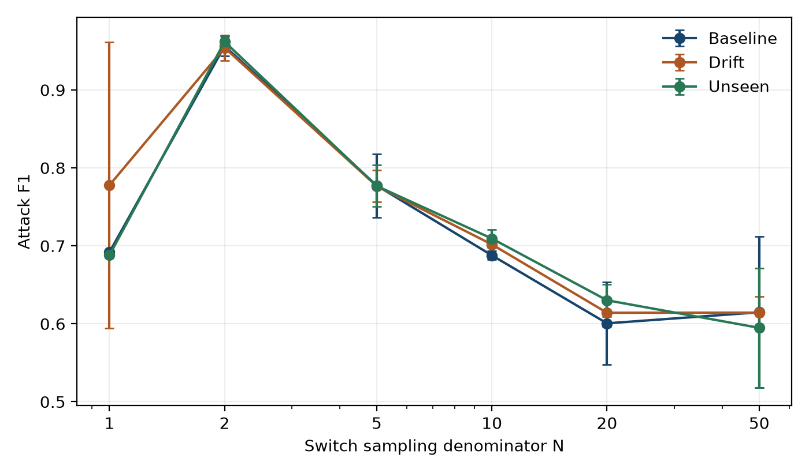
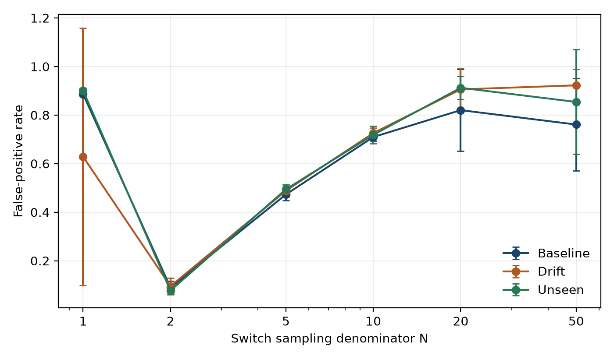
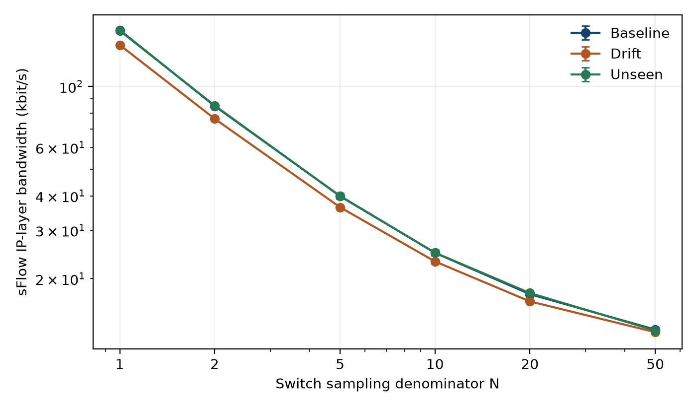
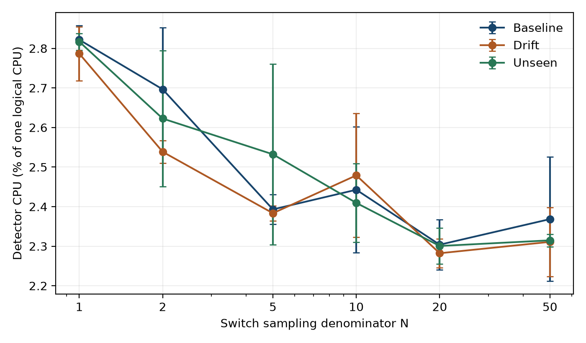

# Sampling and Adaptive Flood Detection in an SDN Emulator

## A controlled, independently validated 5G-NIDD replay study

Research manuscript and reproducibility report. 20 October 2026.

## Abstract

Packet sampling reduces telemetry volume, but the resulting observation and export timing can change online intrusion-detection quality. We evaluate an existing Hoeffding Adaptive Tree with ADWIN using official 5G-NIDD-derived packets in an isolated Mininet/OVS/OS-Ken testbed. A fixed study contains 54 accepted live trials: three scenarios, six switch sampling denominators and three repeats. Every class replays at 100 packets/s. Full sender and receiver captures, kernel packet timestamps and prediction-before-label records independently validate the experimental evidence. Across the 18 cells, mean attack F1 ranges from 0.595 to 0.962. We report channel costs, paired differences, censored physical detection/recovery, quality ablations and a window-size sensitivity check. The contribution is an auditable measurement pipeline and a bounded empirical study, not a new learning algorithm. Constructed traffic timing, oracle supervision and fixed source captures limit deployment and generalization claims.

## 1. Introduction and research questions

SDN monitoring places detection logic near control-plane observations. A useful detector must account for what telemetry it can collect and what collecting it costs. This study asks how actual switch sampling changes prequential flood-detection quality and measured control-channel cost, and how the observed trade-off changes under held-out SYN introduction and a constructed distribution shift. N=1 is an internal unsampled M3 reference. No M1/M2 implementation or cross-method superiority claim is included.

## 2. Related work and contribution boundary

5G-NIDD supplies labelled traffic from a functional 5G test network [1]. ADWIN and adaptive Hoeffding trees are established stream-learning methods [2,3]. Sampling-based SDN DDoS detection and resource trade-offs already appear in Ujjan et al. [4]. HAT/ADWIN stream traffic classification in SDN [5] and incremental 5G malicious-traffic detection [6] further limit any generic novelty claim. Our candidate contribution is instead the reproducible combination of source-to-packet provenance, actual switch exports, independent original-packet truth, causal label revelation and uncertainty-aware repeated measurement. Published classifier scores on different features/splits are not comparable baselines. Detailed source and access notes are in docs/research-related-work.md. Sufficient originality for a specific venue remains a scientific judgement beyond this artifact-completeness assessment.

## 3. Methods

### Fixed protocol and source selection

The frozen protocol is `configs/research_protocol.json`, SHA256
`f8196653b1a0dfe6da652fa75d1aba720a6bd243842292d5a017b8cc2f8cc36d`.
Three scenarios, six N values (1, 2, 5, 10, 20, 50), and three model seeds (42, 43, 44)
yield 54 planned primary trials. Trial order uses seed 20261019. No threshold or
hyperparameter tuning uses primary evaluation outcomes. Technical pilots and
failed attempts remain separate from the randomized matrix.

Exact authoritative flow-family matches supply 27,200 original packet selections
in 40 prepared blocks. Mapping audits found no reused source packet indices or
identical original frame hashes across these selected scenarios. This does not
establish independence of source flows, sessions or capture conditions. Training
and evaluation can still share traffic-generation and flow identities. Raw
addresses, tools, labels and frame hashes never enter the model's feature vector.

A packet inherits a label only through a compatible original bidirectional
endpoint/protocol/time interval, including numeric transport ports for TCP/UDP.
ICMP uses endpoints, protocol and time, without guessed pseudo-ports. The interval
tolerance is 1 microsecond. A SYN flag or an attack-session filename alone is not
evidence that a packet is malicious. Unknown and conflicting matches are excluded
from prepared blocks, rather than relabelled benign.

Full original-stream audits, before selection, gave the following coverage.
These are label-join coverage figures, not classifier scores:

| BS2 session | Original packets | Known benign | Known flood | Unknown |
|---|---:|---:|---:|---:|
| SYN | 93,312 | 64,648 | 14,691 | 13,973 |
| ICMP | 313,667 | 294,232 | 1,079 | 18,356 |
| UDP | 656,389 | 230,118 | 417,404 | 8,867 |

Argus suppresses some numeric zero ports in text output. UDP reconstruction used
binary-flow port-zero filters and exact original record offsets, not blanket
replacement of missing values. Conservative unresolved values remain unknown.
Selection from confidently labelled packets limits representativeness.

Only Ethernet destination/source MAC addresses change. Network-layer headers and
payloads remain original. Packet timestamps become selection_index/100 for replay.
All selected classes use 100 pps. The original dataset's attack intensity, burst
structure and natural chronology are not preserved. This design removes selected
rate-label confounding but cannot estimate line-rate attack performance.

Baseline and unseen scenarios each have 12 eight-second blocks, alternating
benign/attack conditions. Drift has eight eight-second blocks followed by eight
two-second blocks. Two-second gaps separate blocks. The drift post-stage uses
800 confidently matched ICMP packets from the available 1,079. Family and cadence
change together, so this is a joint covariate/cadence-shift scenario. It does not
isolate a causal benefit of ADWIN or demonstrate a natural concept change.

The first four blocks form warm-up. Baseline exposes UDP and SYN during warm-up.
Unseen exposes UDP but excludes SYN from its entire warm-up. Kernel receive events
define physical attack onset. Warm-up and recovery boundaries use the declared
stage schedule relative to each trial's recorded origin, not a natural source
capture change point.

### Isolated live testbed

An OS-Ken OpenFlow 1.3 learning controller drives a four-host Mininet topology and
OVS userspace datapath. The testbed has no physical-network uplink. Bounded
tcpreplay injects verified blocks through the sender interface. The victim's full
received packets and sender's transmitted packets are captured independently.
Expected versus observed whole-frame multiplicities must agree, and capture
kernel drops must be zero. Sampling configuration is read before and after each
trial. OVS sampling randomness is uncontrolled; recorded model seeds do not seed
the switch. Repeats reuse frozen input traffic and measure controlled repeatability.

### Independent supervision and causal order

A separate process in the victim namespace reads full frames using AF_PACKET and
kernel receive timestamps. Full-frame source matching supplies packet truth,
independently of which packets OVS samples. PACKET_AUXDATA restores kernel-stripped
VLAN headers before matching. Unknown or conflicting frames remain unknown.

The observer publishes pure-class window snapshots after a fixed settling
interval. Empty, mixed and unknown windows are unscored; they are never assumed
benign. For every completed feature window, the detector waits a declared 0.5 s,
predicts, records completion time, then opens the independent truth snapshot.
It logs/scores the observation before learning its newly revealed oracle label.
Labels for gaps do not train the classifier. A zero-sample window with known
original-packet truth remains scored and can be a false negative or false positive.

This is delayed **experimental oracle supervision**. A production system does
not know packet truth automatically. The 0.5 s delay contributes to physical alarm
latency and is not presented as pure inference cost.

Precisely, `label_delay_seconds` names a **window-closure holdback**, not a
0.5-second delay after prediction. Once prediction completes, that window's
experimental label is read and learned immediately. This study does not model
asynchronous human annotation or an operational labelling service.

### Features and model

Primary windows are 0.1 s, indexed by collector receipt time. Features are estimated
packets/s and bytes/s (weighted by N), sampled mean packet size, UDP/TCP/ICMP/SYN
fractions, and an empty-window indicator. sFlow export batching, queueing and host
scheduling can delay features relative to packet onset. Error near boundaries is
part of the measured observation pipeline, not removed based on model outcomes.

River HAT uses grace_period 200, threshold 0.5, internal ADWIN delta 0.002, and a
separate external ADWIN prediction-error monitor. The external monitor does not
reset the classifier. Internal branch changes are not inferred from its alarms.
Warm-up observations train but do not contribute to reported quality.

### Measurements

Per-class precision, recall and F1, rank-based tie-aware ROC-AUC, false-positive
rate, and held-out SYN recall use independently labelled evaluation windows.
Physical detection delay uses prediction completion minus original received attack
onset. The top-level delay and packets-to-detect summaries describe the first
post-warm-up attack episode in each trial, averaged only across detected trials.
Per-episode results retain all later episodes. Packets-to-detect counts all
original IP packets from onset through alert completion, not selected samples.
Undetected episodes remain censored. Inference
latency measures only the model's predict call, not export/window/label delay.

CPU values represent percentages of one logical CPU, not the whole machine.
Detector and controller CPU are separate. Flow entries are periodic snapshots.
Resource aggregation excludes pre-origin idle time. Legacy telemetry bandwidth
counts sFlow UDP payload; legacy OpenFlow bandwidth counts captured frame bytes.
The scientific Pareto aliases use a consistent **IP-layer** basis: IPv4/UDP/payload
for sFlow, captured IP packet bytes for OpenFlow. Report both channel components
and their sum, including periodic counter/control traffic. These virtual-link
costs do not measure physical wire overhead or production switch CPU.
The host was not CPU-isolated, and development/verification activity could
overlap collection. CPU and latency therefore describe an instrumented shared
host, not dedicated-host capacity or a controlled hardware benchmark.

Recovery requires rolling balanced accuracy >= 0.90 across 40 scored post-boundary
observations, sustained for three consecutive checks with both classes in each
window. Missing recovery is censored, not zero. Block cadence affects whether this
criterion can be observed and must accompany interpretation.
Reported recovery delay starts at the scheduled stage-8 shift boundary and ends
at the first qualifying check in a confirmed streak. The raw recovery record
also preserves the later confirmation time relative to the trial origin.

### Comparisons and uncertainty

Report all three trial values, mean, sample SD, and an unbounded two-sided 95%
Student-t mean interval. N=3 gives a wide interval with critical value 4.30265.
Pair each N with N=1 using the same scenario/trial identity. This pairing controls
the fixed input/model seed, not OVS sampling RNG. Do not claim independent new
traffic populations or statistical superiority from overlapping/limited repeats.

Quality-only offline ablations consume the exact saved features and causal label
order: HAT, nonadaptive Hoeffding Tree, and a fixed warm-up-majority dummy. These
do not compare equivalent live CPU/latency costs. One-second sensitivity rebuilds
features from the actual raw datagrams and original RX events, not averages of
nonlinear 0.1 s feature vectors. It remains explicitly post-hoc quality sensitivity.

Pareto candidates maximize F1 and minimize measured combined IP-layer channel
bandwidth. A descriptive recommendation minimizes normalized ideal-point distance
with predeclared equal quality/cost weighting. It is not a universal best N.

### Reproducibility and limitations

Retain the manifest, protocol, exact configuration, software revision, dependency
versions, raw datagrams, TX/RX captures, original-packet events, per-window causal
records, resource logs, failed attempts and SHA256 links. A clean checkout excludes
large raw data, prepared captures and local results. Reproduce by downloading the
official release and applying the documented preparation and lab commands.

The selected release/session, constructed timing, flow identity correlations,
oracle labels, low fixed replay rate, short shifts, shared-host scheduling and
uncontrolled sampling limit external validity. No physical 5G/RAN or MEC experiment,
automatic mitigation, broad zero-day guarantee, or causal adaptation advantage is
established by this design. Paper acceptance and sufficient novelty require human
review beyond automated artifact-completeness gates.

## 4. Results

### 4.1 Detection quality

Baseline: the highest cell-mean attack F1 occurs at N=2 (0.956), with false-positive rate 0.090 and 46.94% lower combined channel bandwidth than N=1. This is an observed cell ranking, not an independent optimum or significance test.

Drift: the highest cell-mean attack F1 occurs at N=2 (0.954), with false-positive rate 0.095 and 45.90% lower combined channel bandwidth than N=1. This is an observed cell ranking, not an independent optimum or significance test.

Unseen: the highest cell-mean attack F1 occurs at N=2 (0.962), with false-positive rate 0.077 and 46.40% lower combined channel bandwidth than N=1. This is an observed cell ranking, not an independent optimum or significance test.

#### Baseline

| N | Precision | Recall | F1 mean +/- SD | ROC-AUC | FPR |
|---|---|---|---|---|---|
| 1 | 0.529 | 0.999 | 0.692 +/- 0.003 | 0.696 | 0.887 |
| 2 | 0.918 | 0.998 | 0.956 +/- 0.013 | 0.936 | 0.090 |
| 5 | 0.665 | 0.938 | 0.777 +/- 0.041 | 0.700 | 0.473 |
| 10 | 0.558 | 0.897 | 0.688 +/- 0.006 | 0.542 | 0.710 |
| 20 | 0.491 | 0.788 | 0.601 +/- 0.053 | 0.372 | 0.820 |
| 50 | 0.508 | 0.793 | 0.615 +/- 0.097 | 0.426 | 0.761 |

#### Drift

| N | Precision | Recall | F1 mean +/- SD | ROC-AUC | FPR |
|---|---|---|---|---|---|
| 1 | 0.668 | 0.986 | 0.778 +/- 0.184 | 0.758 | 0.629 |
| 2 | 0.914 | 0.999 | 0.954 +/- 0.016 | 0.940 | 0.095 |
| 5 | 0.659 | 0.945 | 0.776 +/- 0.020 | 0.714 | 0.488 |
| 10 | 0.562 | 0.935 | 0.702 +/- 0.001 | 0.619 | 0.726 |
| 20 | 0.483 | 0.846 | 0.614 +/- 0.019 | 0.388 | 0.906 |
| 50 | 0.481 | 0.853 | 0.614 +/- 0.021 | 0.470 | 0.922 |

#### Unseen

| N | Precision | Recall | F1 mean +/- SD | ROC-AUC | FPR |
|---|---|---|---|---|---|
| 1 | 0.525 | 0.997 | 0.688 +/- 0.003 | 0.772 | 0.901 |
| 2 | 0.928 | 0.998 | 0.962 +/- 0.008 | 0.949 | 0.077 |
| 5 | 0.657 | 0.950 | 0.777 +/- 0.027 | 0.759 | 0.494 |
| 10 | 0.569 | 0.942 | 0.709 +/- 0.011 | 0.608 | 0.719 |
| 20 | 0.491 | 0.880 | 0.630 +/- 0.021 | 0.481 | 0.912 |
| 50 | 0.483 | 0.800 | 0.595 +/- 0.077 | 0.473 | 0.854 |

#### Held-out SYN family

| N | SYN recall mean +/- SD | Correct first SYN-window predictions |
|---|---|---|
| 1 | 0.996 +/- 0.004 | 2/3 |
| 2 | 0.997 +/- 0.002 | 3/3 |
| 5 | 0.975 +/- 0.043 | 3/3 |
| 10 | 0.952 +/- 0.006 | 2/3 |
| 20 | 0.900 +/- 0.039 | 1/3 |
| 50 | 0.813 +/- 0.188 | 2/3 |

SYN is excluded from warm-up, but the detector subsequently learns from oracle SYN labels. Overall SYN recall therefore mixes first encounter with later adaptation. The first-window count is shown separately and is based on only three encounters.

Every cell contains three accepted trials. Error bars in the following figures are sample standard deviations, not confidence intervals. Exact unbounded Student-t intervals and all per-class metrics are retained in the machine-readable tables.

### 4.2 Measured cost

#### Baseline

| N | sFlow IP kbit/s | OpenFlow IP kbit/s | Detector CPU % | Controller CPU % |
|---|---|---|---|---|
| 1 | 160.132 | 0.319 | 2.822 | 0.013 |
| 2 | 84.811 | 0.323 | 2.697 | 0.019 |
| 5 | 39.941 | 0.319 | 2.393 | 0.011 |
| 10 | 24.819 | 0.319 | 2.443 | 0.011 |
| 20 | 17.568 | 0.319 | 2.304 | 0.016 |
| 50 | 13.050 | 0.319 | 2.368 | 0.013 |

At N=50 versus N=1 in baseline, mean combined channel cost changes by -91.67% and mean F1 changes by -0.077. These are descriptive controlled-study differences, not population effect estimates.

#### Drift

| N | sFlow IP kbit/s | OpenFlow IP kbit/s | Detector CPU % | Controller CPU % |
|---|---|---|---|---|
| 1 | 141.318 | 0.491 | 2.787 | 0.006 |
| 2 | 76.233 | 0.491 | 2.539 | 0.017 |
| 5 | 36.345 | 0.491 | 2.383 | 0.011 |
| 10 | 23.092 | 0.495 | 2.479 | 0.012 |
| 20 | 16.532 | 0.495 | 2.282 | 0.017 |
| 50 | 12.776 | 0.494 | 2.311 | 0.011 |

At N=50 versus N=1 in drift, mean combined channel cost changes by -90.64% and mean F1 changes by -0.164. These are descriptive controlled-study differences, not population effect estimates.

#### Unseen

| N | sFlow IP kbit/s | OpenFlow IP kbit/s | Detector CPU % | Controller CPU % |
|---|---|---|---|---|
| 1 | 159.293 | 0.471 | 2.817 | 0.011 |
| 2 | 85.164 | 0.471 | 2.623 | 0.011 |
| 5 | 39.853 | 0.475 | 2.532 | 0.013 |
| 10 | 24.849 | 0.471 | 2.409 | 0.011 |
| 20 | 17.729 | 0.471 | 2.301 | 0.008 |
| 50 | 12.953 | 0.475 | 2.315 | 0.011 |

At N=50 versus N=1 in unseen, mean combined channel cost changes by -91.60% and mean F1 changes by -0.093. These are descriptive controlled-study differences, not population effect estimates.

### 4.3 Physical alerts and constructed shift recovery

| Scenario | N | First-episode delay (s) | Detected /3 | Original packets to alert | Recovery mean (s) | Recovered /3 |
|---|---|---|---|---|---|---|
| baseline | 1 | 0.635 | 3/3 | 64.0 | NA | 0/3 |
| baseline | 2 | 0.579 | 3/3 | 58.3 | NA | 0/3 |
| baseline | 5 | 0.579 | 3/3 | 58.3 | NA | 0/3 |
| baseline | 10 | 0.569 | 3/3 | 57.0 | NA | 0/3 |
| baseline | 20 | 1.493 | 3/3 | 150.0 | NA | 0/3 |
| baseline | 50 | 1.201 | 3/3 | 120.7 | NA | 0/3 |
| drift | 1 | 0.629 | 3/3 | 63.3 | 6.504 | 1/3 |
| drift | 2 | 0.561 | 3/3 | 56.3 | 6.506 | 3/3 |
| drift | 5 | 0.595 | 3/3 | 60.0 | NA | 0/3 |
| drift | 10 | 0.588 | 3/3 | 59.3 | NA | 0/3 |
| drift | 20 | 1.535 | 3/3 | 153.7 | NA | 0/3 |
| drift | 50 | 1.368 | 3/3 | 137.3 | NA | 0/3 |
| unseen | 1 | 0.597 | 3/3 | 60.3 | NA | 0/3 |
| unseen | 2 | 0.584 | 3/3 | 58.7 | NA | 0/3 |
| unseen | 5 | 0.587 | 3/3 | 59.3 | NA | 0/3 |
| unseen | 10 | 0.709 | 3/3 | 71.0 | NA | 0/3 |
| unseen | 20 | 0.769 | 3/3 | 77.7 | NA | 0/3 |
| unseen | 50 | 1.287 | 3/3 | 129.3 | NA | 0/3 |

Delay and packets-to-alert summarize the first post-warm-up attack episode per trial. NA retains censored or inapplicable outcomes. Delay means condition on observed detection and must be read together with the detected count; they are not average delays with misses assigned zero. Recovery applies only to the declared drift scenario. Per-episode packet counts, misses and false alarms remain in each run's research_metrics.

The following counts are external ADWIN prediction-error alarms during evaluation in the constructed drift scenario. An alarm does not itself establish an attack or a HAT internal branch replacement; internal adaptation events were not instrumented.

| N | External alarms in trials 1, 2, 3 | Mean count |
|---|---|---|
| 1 | 2, 0, 3 | 1.67 |
| 2 | 0, 0, 0 | 0.00 |
| 5 | 2, 1, 2 | 1.67 |
| 10 | 2, 1, 1 | 1.33 |
| 20 | 2, 2, 2 | 2.00 |
| 50 | 2, 2, 2 | 2.00 |

### 4.4 Paired uncertainty, ablations and window sensitivity

Unseen paired N=50 minus N=1 attack-F1 change: mean -0.093, 95% Student-t interval [-0.287, 0.101], n=3. The three fixed-traffic repeats cannot establish broad statistical superiority.

Baseline paired N=50 minus N=1 attack-F1 change: mean -0.077, 95% Student-t interval [-0.315, 0.161], n=3. The three fixed-traffic repeats cannot establish broad statistical superiority.

Drift paired N=50 minus N=1 attack-F1 change: mean -0.164, 95% Student-t interval [-0.660, 0.333], n=3. The three fixed-traffic repeats cannot establish broad statistical superiority.

| Scenario | N | HAT F1 | HT F1 | Warm-up majority F1 | One-second HAT F1 |
|---|---|---|---|---|---|
| baseline | 1 | 0.692 | 0.694 | 0.444 | 0.645 |
| baseline | 2 | 0.956 | 0.953 | 0.000 | 0.666 |
| baseline | 50 | 0.615 | 0.573 | 0.222 | 0.789 |
| drift | 1 | 0.778 | 0.738 | 0.000 | 0.612 |
| drift | 2 | 0.954 | 0.946 | 0.000 | 0.682 |
| drift | 50 | 0.614 | 0.601 | 0.222 | 0.724 |
| unseen | 1 | 0.688 | 0.688 | 0.222 | 0.640 |
| unseen | 2 | 0.962 | 0.955 | 0.000 | 0.654 |
| unseen | 50 | 0.595 | 0.576 | 0.000 | 0.770 |

All six N values' ablations are included in the derived archive. These are offline quality-only comparisons. The one-second study changes the observation unit, available warm-up observations and eligible pure-class support; it does not compare equivalent live runtime or isolate only a statistical aggregation effect.

### 4.5 Descriptive frontier

The saved pareto_recommendations.json identifies nondominated points and the fixed equal-weight normalized ideal-point recommendation separately by scenario. All individual trials and uncertainty remain available. A selected N is an in-study operational suggestion under this cost definition, not an externally validated optimum.

| Scenario | Suggested N | Mean F1 | Combined IP kbit/s |
|---|---|---|---|
| drift | 2 | 0.954 | 76.724 |
| baseline | 2 | 0.956 | 85.134 |
| unseen | 2 | 0.962 | 85.635 |

## 5. Discussion and threats to validity

Sampling affects more than feature volume. Sparse exports and batching can produce empty arrival windows even when original attack packets arrive. Retaining those windows is necessary to measure the deployed observation path. Independent truth makes these misses visible instead of scoring only selected packets. High recall accompanied by a high false-positive rate remains a poor operating point, and an overhead reduction alone does not establish a useful detector. The reported ablations and uncertainty should guide the interpretation rather than an isolated best run.

The study uses selected sessions from one release and one isolated shared-host testbed. Source-flow identity correlations are not removed by disjoint packet indices. Equal-rate retiming deliberately removes natural volume and burst structure. Drift changes family and cadence together. Oracle labels enable supervised adaptation that production cannot assume. N=1 is not full PacketIn mirroring, and M1/M2 are outside scope. CPU and latency reflect this instrumented software testbed, not physical switch or 5G capacity. Human review must assess whether the bounded findings provide sufficient novelty for a venue.

The primary sampling curve is non-monotonic: observing every eligible header does not yield the strongest classifier here. Export batching, feature timing and the online learner's state are plausible explanations, but this design does not isolate their causal effects. The nonadaptive-tree ablation and one-second sensitivity show that conclusions depend on the learner and observation schedule. No general HAT adaptation advantage follows from the primary F1 ranking. Even the strongest cells retain material false positives, so the study does not establish production readiness.

## 6. Reproducibility and completion evidence

The repository includes the frozen protocol, preparation code, provenance manifest, resumable trial runner, analysis, tests and this report generator. The derived evidence archive contains per-window features/predictions, packet event hashes, resource/drift logs, trial summaries and sensitivity outputs for all 54 accepted trials. It excludes original packet payloads. Raw local captures and exports remain linked by SHA256. Technical failures and retry explanations remain in the matrix/evidence index and are not silently replaced. A clean checkout requires the official dataset download before rerunning the live study.

## 7. Conclusion

This controlled study produces independently validated evidence for the accuracy-cost trade-off of sampled adaptive flood detection. Its results support conclusions limited to the reported constructed scenarios, instrumentation and supervision policy. The software and evidence package support research review; they do not establish a new learning algorithm, universal sampling optimum, physical 5G deployment performance, or guaranteed publication acceptance.

## References

[1] S. Samarakoon et al. 5G-NIDD: A Comprehensive Network Intrusion Detection Dataset Generated over 5G Wireless Network. arXiv:2212.01298, 2022. https://arxiv.org/abs/2212.01298

[2] A. Bifet and R. Gavalda. Learning from Time-Changing Data with Adaptive Windowing. SDM 2007, 443-448. https://doi.org/10.1137/1.9781611972771.42

[3] A. Bifet and R. Gavalda. Adaptive Learning from Evolving Data Streams. IDA 2009. https://doi.org/10.1007/978-3-642-03915-7_22

[4] R. M. A. Ujjan et al. Towards sFlow and adaptive polling sampling for deep learning based DDoS detection in SDN. FGCS 111, 763-779, 2020. https://doi.org/10.1016/j.future.2019.10.015

[5] A. M. Eldhai et al. Improved Feature Selection and Stream Traffic Classification Based on Machine Learning in Software-Defined Networks. IEEE Access 12, 34141-34159, 2024. https://doi.org/10.1109/ACCESS.2024.3370435

[6] Z. Wang, K. W. Fok and V. L. L. Thing. Exploring Emerging Trends in 5G Malicious Traffic Analysis and Incremental Learning Intrusion Detection Strategies. arXiv:2402.14353, 2024. https://arxiv.org/abs/2402.14353

[7] P. Phaal and M. Lavine. sFlow Version 5. 2004. https://sflow.org/sflow_version_5.txt
